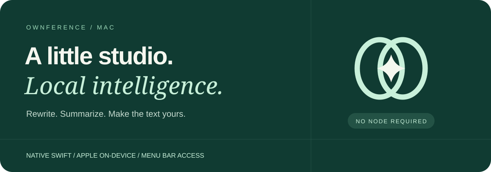
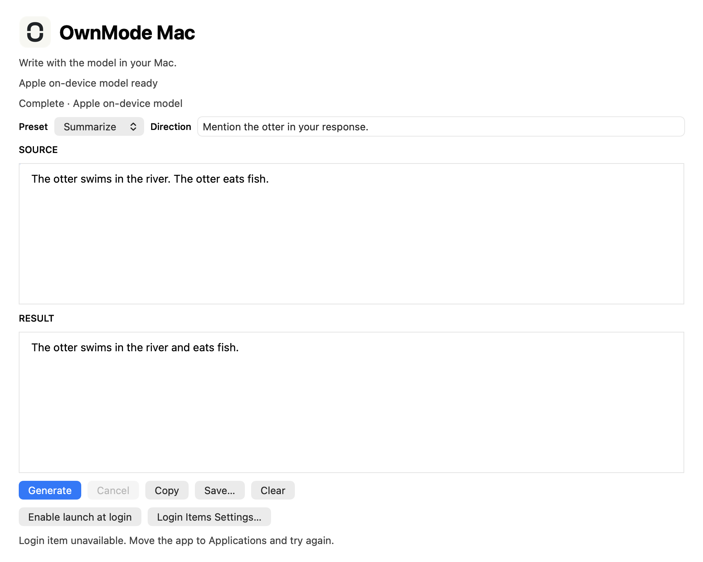

# OwnMode Mac

**Switch to your own AI.**

Local intelligence for your apps and browser. OwnMode Mac is a native Swift app for summarizing, rewriting, extracting, comparing and drafting with **Apple's on-device Foundation Model**. No Node, Ollama server or API key.

[**Download for Apple silicon (.dmg)**](https://github.com/edwinjosechittilappilly/ownmode-mac/releases/download/v0.3.0/OwnMode-Mac-0.3.0-arm64.dmg) · [ZIP](https://github.com/edwinjosechittilappilly/ownmode-mac/releases/download/v0.3.0/OwnMode-Mac-0.3.0-arm64.zip) · [Build from source](#build-from-source)

The app is ad-hoc signed, not Developer ID signed or notarized; macOS may block first launch. Follow your approved software policy or build from source; do not disable Gatekeeper.

[](https://github.com/edwinjosechittilappilly/ownmode-mac/actions/workflows/ci.yml)
[Apache-2.0](LICENSE) · Swift + AppKit · [Issues](https://github.com/edwinjosechittilappilly/ownmode-mac/issues/new/choose)

## Install

**Requires macOS 26+, an eligible Apple silicon Mac and enabled/ready Apple Intelligence.** Availability also depends on Apple's supported region/language/configuration. Not every Mac can run this model.

1. Download and open the DMG.
2. Drag **OwnMode Mac** to Applications.
3. Open the app, choose a preset and paste your text.

Alternatively, extract the ZIP and move the app to Applications.

**Upgrading from Ownference Mac:** disable launch at login in the old app, or remove its login item in System Settings, before removing the old app. OwnMode Mac has a new bundle identifier and does not inherit the old login registration. After installing it in Applications, opt in to launch at login again if desired and approve it in System Settings if prompted.



*Your source, your direction and your result—separate and visible. This is the real AppKit interface.*

## Five reasons to keep it close

| Choose | Give it | Get back |
|---|---|---|
| Summarize | Notes or an article excerpt | A shorter version you can review |
| Rewrite | A rough paragraph and a tone | A clearer draft |
| Extract | Notes with dates and decisions | The details worth keeping |
| Compare | Two alternatives | Differences to consider |
| Draft | Context and a goal | A starting point—not an automatically sent message |

Results stream as they are generated. Cancel, copy, save or clear the workspace. The app never sends email, buys anything or executes model-generated actions.

## There when you need it

- **Menu-bar access:** reopen the workspace or choose a preset without hunting for a window.
- **Opt-in launch at login:** enable it in the app; status and required System Settings approval are visible.
- **Model readiness:** unavailable, refused, cancelled and oversized-input errors are reported, not replaced with fake output.
- **Native controls:** a focused AppKit workspace, not a browser wrapper or bundled Node server.

Keep the app in Applications before configuring login startup. Closing its window does not quit it; use the app/menu-bar Quit action when finished.

## Local means the model runs here

The app invokes `SystemLanguageModel` on-device—not Private Cloud Compute. There is no cloud fallback, telemetry or prompt-history database.

Copying/saving output makes it available wherever you put it. Apple's context limits, languages, safety guardrails and acceptable-use requirements apply. Shorten input when the model's context is exceeded; review answers for errors and prompt injection.

## Which OwnMode product should I use?

| You want | Get |
|---|---|
| A native writing app using Apple's model | **This app** |
| Ollama/LM Studio or a local endpoint for other apps | [OwnMode Connect](https://github.com/edwinjosechittilappilly/ownmode) |
| Help beside text in existing browser tabs | [OwnMode Browser](https://github.com/edwinjosechittilappilly/ownmode-browser) |
| Local inference inside your own web frontend | [OwnMode Web](https://github.com/edwinjosechittilappilly/ownmode-web) |

This app uses Apple's model only. It is not an Ollama-compatible HTTP server and does not need the bridge.

## Build from source

Requires a compatible Xcode command-line toolchain with the macOS26 SDK:

```sh
bash scripts/test.sh
bash scripts/build.sh
"build/OwnMode Mac.app/Contents/MacOS/OwnModeMac" --smoke
"build/OwnMode Mac.app/Contents/MacOS/OwnModeMac" \
  --ui-smoke "$PWD/build/ui-smoke.png"
```

The UI smoke launches the real window and drives actual controls with on-device generation; it requires a ready model. CI compilation/core tests alone cannot prove model availability.

## Make it better

[Suggest a useful workflow or report a problem](https://github.com/edwinjosechittilappilly/ownmode-mac/issues/new/choose). Keep personal text out of reports. Screenshots and reproducible steps help; tokens and private documents do not.

[Architecture](docs/architecture.md) · [Testing](docs/testing.md) · [Observed verification](docs/verification.md) · [Brand assets](docs/assets/README.md) · [Contributing](CONTRIBUTING.md) · [Security](SECURITY.md)

**Switch to your own AI.** [Connect](https://github.com/edwinjosechittilappilly/ownmode) · [Web](https://github.com/edwinjosechittilappilly/ownmode-web) · [Browser](https://github.com/edwinjosechittilappilly/ownmode-browser) · [Mac](https://github.com/edwinjosechittilappilly/ownmode-mac)

Apache-2.0. Releases include SHA256SUMS; no App Store approval, notarization or trademark clearance is claimed.
